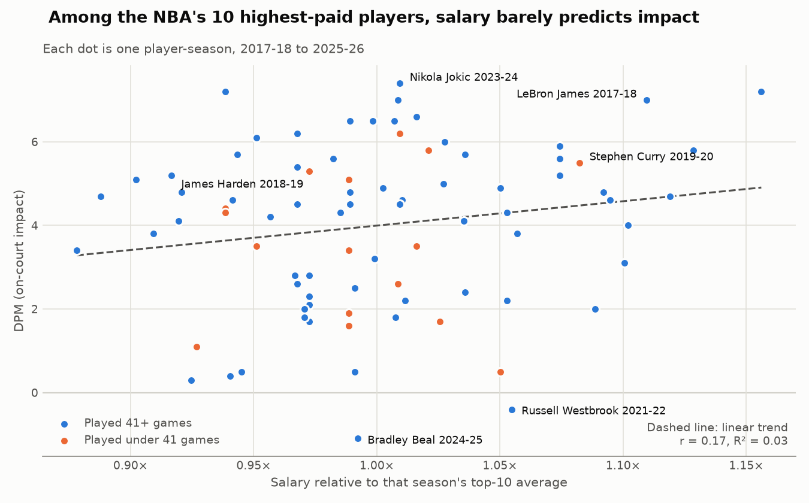

# NBA Salary vs. Performance, 2017-18 to 2025-26

Are the NBA's highest-paid players worth what they're paid? This project
scrapes the 10 highest salaries in each season from Spotrac and joins them to
each player's production and impact numbers from databallr. It then measures
what teams actually got for that money.

**Pipeline:** Selenium scrapers → pandas merge and cleaning → analysis and chart
(`analyze.py`).
**Dataset:** 100 player-seasons. Of these, 84 have stats: the 2026-27 season
hasn't been played yet, and 6 player-seasons had zero games.

## Results



### 1. Salary barely predicts performance at the top of the market

Within each season's top 10, a bigger contract says almost nothing about who
plays better. To compare across years despite salary-cap growth, I expressed
each salary as a multiple of that season's top-10 average.

| Salary vs. … | Correlation (r) | R² |
|---|---|---|
| DPM (on-court impact) | 0.17 | 0.03 |
| Points per game | 0.15 | 0.02 |
| True shooting % | 0.22 | 0.05 |
| Games played | 0.01 | 0.00 |

Salary explains about 3% of the variation in impact. One reason is that these
contracts are usually signed years before the season they pay for, so they
reward past performance and can't foresee injuries or decline. *Caveat:* only
the top 10 are included, so salaries span a narrow range (0.88× to 1.16× the
season average). That narrow range tends to understate any correlation. The
result means "among max-level players, more money ≠ more production." It does
not mean salary is unrelated to skill league-wide.

### 2. The cost of a point has more than doubled, and availability drives it more than salary inflation

| Season | Median salary | Avg. games played | Median cost per point scored |
|---|---|---|---|
| 2017-18 | $28.7M | 61 | $22.7K |
| 2018-19 | $32.4M | 69 | $21.0K |
| 2021-22 | $41.6M | 56 | $29.3K |
| 2023-24 | $47.2M | 68 | $26.3K |
| 2025-26 | $54.1M | 47 | **$53.1K** |

Median top-10 salary rose 89% from 2017-18 to 2025-26. Median cost per point
rose 134%, because these players also played fewer games: an average of 47 in
2025-26 versus 61 in 2017-18. Years with good health (2018-19, 2023-24) kept
cost per point flat even as salaries grew. Separately, **$225M** went to six
player-seasons with zero games played: Hayward 2017-18, Durant and Wall
2019-20, Thompson 2020-21, and Wall and Leonard 2021-22.
*(2019-20 and 2020-21 were shortened by COVID, which inflates cost per point
in those years.)*

### 3. Best value and most overpaid

**Best value**
- **James Harden, 2018-19:** 36.1 PPG over 78 games, at **$10.8K per point**.
  That is the lowest of any player-season, about half that year's median.
- **Nikola Jokic, 2023-24:** the highest impact in the dataset (DPM +7.4) over
  79 games, at almost exactly the average top-10 salary.
- **LeBron James, 2017-18:** played all 82 games with a DPM of +7.0, at
  $14.8K per point.

**Most overpaid**
- **Bradley Beal, 2024-25:** $50.2M for a **negative impact** (DPM −1.1), the
  lowest in the dataset.
- **Russell Westbrook, 2021-22:** $44.2M with a DPM of −0.4. He played 78
  games, so the issue was performance, not availability.
- **Stephen Curry, 2019-20:** $40.2M for 5 games, or **$8.0M per game**.
- **Joel Embiid, 2023-24 to 2025-26:** $154M for 96 games, or $1.6M per game
  played. That is the worst per-game rate among players with 3+ top-10
  seasons.

Full per-player-season numbers are in
[`output/player_season_value.csv`](output/player_season_value.csv).

**Metric notes:** *Cost per point* = salary ÷ (PPG × games played). *DPM* is
databallr's plus-minus estimate of a player's on-court impact (0 ≈ league
average, higher is better). Win shares weren't part of the scraped data, so
DPM serves as the all-in-one impact measure.

## Project structure

| File | What it does |
|---|---|
| `scrape_salaries.py` | Scrapes the top-10 salaries per season from Spotrac → `data/salaries_raw.csv` |
| `scrape_performance.py` | Looks up each player's season stats on databallr → `data/performance_raw.csv` |
| `driver_setup.py` | Shared Selenium Chrome driver (ChromeDriver auto-installed by webdriver-manager) |
| `merge_export.py` | Joins and cleans both sources → `output/nba_top10_salary_performance.csv/.xlsx` |
| `analyze.py` | Value metrics, correlations, and the chart → `images/`, `output/player_season_value.csv` |

To reproduce the results from the included data, without scraping:

```bash
pip install -r requirements.txt
python analyze.py
```

---

# Setup guide: running the scrapers (VS Code)

## ⚠️ Before you start: read this

Both sites render data with JavaScript and Spotrac actively blocks simple bots,
which is why Selenium (a real browser) is required instead of `requests`.

### robots.txt compliance (already built into the scripts)

Both sites' `robots.txt` files list a `User-agent: *` group with rules that
apply to general-purpose crawlers — which is what this Selenium script is,
since it identifies as a normal Chrome browser rather than a named bot. Note
that the AI-crawler-specific blocks some sites publish (for tokens like
`GPTBot`, `ClaudeBot`, `anthropic-ai`) govern those companies' own crawlers
and don't apply here — the relevant rules are the general ones:

- **Spotrac**: `Crawl-delay: 5` — `scrape_salaries.py` enforces a hard
  5-second-minimum pause between page loads. It also refuses to build a URL
  touching disallowed paths (`/nba/trade-machine/`, `/application/`,
  `/system/`, `/vendor/`, `/assets/`, `/login/`, `/dashboard/`) or query
  params (`filter=`, `page=`, `search=`) — see `assert_path_allowed()` in
  that file.
- **databallr**: mostly permissive, but `scrape_performance.py` still guards
  against backend/admin paths (`/admin/`, `/api/private/`, `/auth/`,
  `/payment-`, `/subscription`, etc.) in case you extend the script to call
  an API endpoint directly instead of using the on-page search box.

**You should still verify this yourself** before running at scale — open
`https://www.spotrac.com/robots.txt` and `https://databallr.com/robots.txt`
directly in a browser and compare against the `DISALLOWED_PATH_FRAGMENTS`
lists in each script, since site policies can change.

### Other things to keep in mind

- Also check each site's **Terms of Service** — robots.txt covers crawler
  behavior, but ToS may separately restrict scraping or redistribution
  regardless of what robots.txt allows.
- Scrape only what you need (10 years × top 10 = 100 rows) — don't crawl the
  entire site.
- This is intended for personal/analytical use. If you plan to publish or
  redistribute the data commercially, check licensing terms first.
- **Site layouts change.** The CSS selectors in these scripts are starting
  points — you WILL need to open DevTools (see Step 5) and adjust them to
  match the current live HTML before this will reliably work.

---

## Step 1 — Install prerequisites

1. Install **Python 3.10+**: https://www.python.org/downloads/
   - On Windows, check "Add Python to PATH" during install.
2. Install **VS Code**: https://code.visualstudio.com/
3. Install **Google Chrome** (the script uses ChromeDriver): https://www.google.com/chrome/
4. In VS Code, install the **Python extension** (Microsoft) from the
   Extensions panel (`Ctrl+Shift+X` / `Cmd+Shift+X`).

---

## Step 2 — Open the project in VS Code

1. Unzip/copy this project folder somewhere, e.g. `~/nba_scraper`.
2. In VS Code: `File → Open Folder…` → select `nba_scraper`.
3. Open a terminal inside VS Code: `Terminal → New Terminal`.

---

## Step 3 — Create a virtual environment

In the VS Code terminal:

```bash
# Mac/Linux
python3 -m venv venv
source venv/bin/activate

# Windows
python -m venv venv
venv\Scripts\activate
```

You should see `(venv)` appear in your terminal prompt.

In VS Code, also select this interpreter: `Ctrl+Shift+P` → "Python: Select
Interpreter" → choose the one inside `./venv`.

---

## Step 4 — Install dependencies

```bash
pip install -r requirements.txt
```

This installs: `selenium`, `webdriver-manager`, `pandas`, `openpyxl`.

`webdriver-manager` automatically downloads the right ChromeDriver version for
your installed Chrome, so you don't have to manage that manually.

---

## Step 5 — Inspect the live page and fix selectors (IMPORTANT)

Site HTML changes over time, and I can't guarantee the selectors in
`scrape_salaries.py` / `scrape_performance.py` match what's live today. Do
this once before running:

1. Open the target page in Chrome (e.g. `spotrac.com/nba/rankings`).
2. Right-click the data table → **Inspect**.
3. Hover over the row/column elements in DevTools to find the actual CSS
   class names or table structure (e.g. `table.rankings tbody tr`).
4. Update the `SELECTORS` dictionary at the top of each script to match.
5. Do the same for `databallr.com/stats` (look for the table, and note that
   it likely needs a filter/search box interaction to find a specific player
   — the script includes a search-box example you'll need to adjust).

This step is unavoidable with browser scraping — sites don't publish stable
scraping APIs, so selectors are the one part you must verify yourself.

---

## Step 6 — Run the scrapers

```bash
python scrape_salaries.py       # -> data/salaries_raw.csv
python scrape_performance.py    # -> data/performance_raw.csv
python merge_export.py          # -> output/nba_top10_salary_performance.xlsx
python analyze.py               # -> images/salary_vs_impact.png, output/player_season_value.csv
```

Run them one at a time so you can fix selector issues before moving to the
next stage. Each script prints progress and errors per season/player so you
can see exactly where it fails.

---

## Step 7 — Check the output

Open `output/nba_top10_salary_performance.xlsx` in Excel, or the `.csv`
version, and confirm:
- 10 seasons × 10 players = up to 100 rows
- Salary + performance columns are both populated
- No duplicate players/seasons

---

## Troubleshooting

| Problem | Likely cause | Fix |
|---|---|---|
| `selenium.common.exceptions.NoSuchElementException` | Selector is outdated | Redo Step 5 for that page |
| Script hangs / times out | Page hasn't finished loading JS | Increase `WebDriverWait` timeout in the script |
| Chrome closes immediately | Bot-detection triggered | Try `headless=False` to watch it happen, add longer random delays, avoid running too many iterations back-to-back |
| Missing players in performance data | Name mismatch (e.g. "Steph Curry" vs "Stephen Curry") | Add name normalization mapping in `merge_export.py` |

